# UniX — Unified Digital Campus Ecosystem

<p align="center">
  
</p>

<p align="center">
  <strong>A centralized, web-based digital platform empowering university students through peer-to-peer skill exchange, campus marketplace, lost-and-found recovery, tutoring management, real-time messaging, and gamification.</strong>
</p>

<p align="center">
  
  
  
  
  
</p>

---

## 📌 Abstract

> In modern campus environments, students often rely on multiple disconnected platforms for communication, skill sharing, buying and selling items, lost-and-found reporting, tutoring, and peer assistance. This fragmentation leads to inefficiency, delays, missed opportunities, and poor coordination among users. Many existing systems are not campus-specific and therefore fail to provide a structured, reliable, and integrated solution for managing these activities.
>
> This project proposes **UniX**, a unified web-based campus platform developed to simplify and enhance student life by integrating multiple essential services into a single digital ecosystem. The system combines key functionalities such as a **skill exchange system**, **campus marketplace**, **lost-and-found service**, **tutoring management**, and **real-time communication** within one platform, thereby reducing dependence on multiple applications. It also incorporates user-centric features including **personalized profiles**, **dashboards**, **notifications**, and **engagement mechanisms** such as points, streaks, and badges to encourage active participation and community interaction. Administrative controls are included to monitor system activities and maintain reliability and integrity.
>
> The platform aims to provide a structured and efficient environment in which users can collaborate, share resources, and solve everyday campus-related problems more effectively. The expected outcome is a user-friendly, scalable, and practical solution that improves collaboration, communication, and accessibility, thereby enhancing the overall campus experience through a unified and centralized digital platform.

---

## ⚡ The Challenge vs. The UniX Solution

| The Traditional Campus Dilemma | The UniX Unified Solution |
| :--- | :--- |
| **Scattered WhatsApp/Telegram groups** for buying/selling, finding lost items, and finding study partners. | **Dedicated, structured modules** tailored exclusively for student campus workflows. |
| **Unverified participants and scam vulnerabilities** with zero campus identity confirmation. | **Authenticated student access** with university roll numbers, profile vetting, and role governance. |
| **No incentive for peer mentorship**; students struggle to find timely academic or technical assistance. | **Gamified Skill Exchange & Tutoring** with reward points, streak tracking, and badges. |
| **Missed lost-and-found alerts** lost in rapid message feeds. | **Persistent, searchable Lost & Found board** with real-time claim status and item imaging. |
| **Administrative disconnect** with no campus-level oversight or moderation capabilities. | **Centralized Admin Dashboard** to monitor platform health, verify disputes, and track engagement. |

---

## 🌟 Core Modules & Capabilities

```mermaid
graph TD
    A[UniX Ecosystem] --> B[Skill Exchange System]
    A --> C[Campus Marketplace]
    A --> D[Lost & Found Board]
    A --> E[Tutoring & Courses]
    A --> F[Real-Time Messaging]
    A --> G[Gamification & Rewards]
    A --> H[Admin Oversight]
    
    B --> B1[Post Requests with Bounty Points]
    B --> B2[Atomic Cloud Function Workflows]
    
    C --> C1[Student Listings & Image Uploads]
    C --> C2[Category Filtering & Price Quotes]
    
    D --> D1[Report Lost / Found Items]
    D --> D2[Resolved / Claim Tracking]
    
    E --> E1[Create & Browse Courses]
    E --> E2[Enrollments & Live Sessions]
    
    F --> F1[Direct Peer-to-Peer Chat]
    F --> F2[Unread Indicators & Notifications]
    
    G --> G1[Points, Streaks & Badges]
    G --> G2[Personalized Dashboard & Activity Feed]
    
    H --> H1[User & Content Moderation]
    H --> H2[Metrics & System Health]
```



### 1. 🔄 Peer-to-Peer Skill Exchange
- **Request Assistance**: Students can post requests detailing academic or technical needs with point rewards.
- **Application Flow**: Peers apply to assist; request owners review profiles and accept applicants.
- **Atomic Transactions**: Powered by Cloud Functions transactions (`applyToRequest`, `cancelApplication`, `withdrawApplication`) ensuring balance safety and concurrency control.

### 2. 🛒 Campus Marketplace
- **Hyperlocal Commerce**: Buy and sell secondhand textbooks, lab instruments, hostel electronics, and project components within the university circle.
- **Listing Management**: Upload item images via Firebase Storage, set prices, and filter by category and status.
- **Direct Seller Inquiries**: Connect with sellers instantly via integrated messaging.

### 3. 🔍 Lost & Found Portal
- **Fast Reporting**: Broadcast lost belongings or report discovered articles with locations, descriptions, and photographs.
- **Status Lifecycle**: Track items from `Active` to `Claimed` / `Returned`.
- **Search & Filters**: Quickly scan by location tags, categories, or date of incident.

### 4. 🎓 Tutoring & Academic Course Management
- **Peer Tutoring**: Qualified students list specialized tutoring courses with schedules, syllabus overviews, and meeting links.
- **My Learning Dashboard**: Students monitor active enrollments, join upcoming sessions, and review completed subjects.
- **Session Scheduling**: Coordinate one-on-one or group academic workshops seamlessly.

### 5. 💬 Real-Time Messaging & Chat
- **Instant Communication**: Direct peer-to-peer chat powered by Firestore real-time listeners.
- **Secure Participant Scoping**: Security rules restrict conversation visibility strictly to chat participants (`uid1_uid2`).
- **Contextual Inquiries**: Direct message buttons built into marketplace items and skill exchange posts.

### 6. 🏆 Gamification, Points & Dashboard
- **Campus Economy**: Earn points by helping peers, maintaining daily login streaks, and completing tutoring sessions.
- **Badges & Streaks**: Unlock achievement badges (e.g., *Campus Helper*, *Knowledge Master*, *Streak Champion*).
- **Comprehensive Dashboard**: Real-time stats, recent campus transactions, notification center, and quick-action shortcuts.

### 7. 🛡️ Role-Based Access & Admin Panel
- **Security First**: Role-based access control differentiating Students, Tutors, and Administrators.
- **Admin Dashboard**: Moderation controls to inspect user reports, audit transaction logs, verify disputed items, and maintain community trust.

---

## 🎨 UI/UX Design System

UniX features a **Dark Campus Tech** design aesthetic inspired by modern developer platforms and cyber surfaces:
- **Design Tokens**: Deep space background (`#07090F`), rich surface tiles (`#121826`), vibrant neon cyan (`#00E5FF`) and neon emerald (`#00FF7F`) accents.
- **Glassmorphism**: Backdrop-filter blur cards with frosted-glass borders and soft neon ambient glows.
- **Typography**: Bold geometric headings (`Syne`) paired with clean, readable body typography (`DM Sans` / `Inter`).
- **Dynamic Theming**: Interactive Light/Dark theme switcher with persistent local state and smooth transition keyframes.
- **Micro-Interactions**: Hover elevation, animated numeric counters, glowing borders, and loading skeletons.

---

## 🛠️ Architecture & Tech Stack

- **Frontend**: Vanilla JavaScript (ES6+ Modules), Semantic HTML5, Modular CSS3 Design Tokens.
- **Backend-as-a-Service (BaaS)**: Google Firebase (Modular v12.9 SDK)
  - **Firebase Authentication**: Email/Password authentication, email verification, student register validation.
  - **Cloud Firestore**: High-performance NoSQL database for real-time document sync.
  - **Firebase Storage**: Secure cloud asset and image uploads for listings, lost-and-found items, and avatars.
  - **Cloud Functions for Firebase (v2)**: Node.js serverless functions handling atomic point transfers, balance adjustments, and audit trails.
- **Security & Validation**: Production-grade `firebase.rules` with fine-grained document ownership checks, immutable role enforcement, and input shape sanitization.
- **Automated Testing**: Node.js native test runner (`node:test`) paired with `@firebase/rules-unit-testing`.

---

## 📂 Project Directory Structure

```text
UniX/
├── index.html                   # Public landing page with hero, features, and dynamic counters
├── login.html                   # Student & Admin authentication login
├── signup.html                  # Student registration with department & roll number validation
├── navbar.html                  # Global dynamic navigation bar component
├── home.html                    # Quick-redirect to index landing
│
├── pages/                       # Core authenticated application pages
│   ├── about.html               # Mission, team, and platform introduction
│   ├── admin.html               # Administration portal & oversight panel
│   ├── chat.html                # Real-time peer-to-peer messaging
│   ├── dashboard.html           # Student home dashboard with stats, streaks & notifications
│   ├── lostfound.html           # Lost and Found reporting and claim board
│   ├── marketplace.html         # Campus marketplace for buying & selling items
│   ├── profile.html             # User profile, badges, history & activity settings
│   ├── skills.html              # Peer-to-peer skill exchange & request system
│   └── tutoring/                # Tutoring & academic course management
│       ├── browse.html          # Browse available peer tutoring sessions
│       ├── create.html          # Create and publish a new course
│       ├── manage.html          # Tutor course and attendee management
│       ├── my-learning.html     # Enrolled student learning dashboard
│       └── session.html         # Live session details and classroom links
│
├── css/                         # Modular CSS stylesheets
│   ├── auth.css                 # Auth forms and onboarding layout
│   ├── dashboard.css            # Dashboard widgets, stats & feed styling
│   ├── global.css               # Shared utility classes and base resets
│   ├── home.css                 # Landing page styles and animations
│   ├── navbar.css               # Sticky glassmorphism navbar and dropdowns
│   ├── skills.css               # Skill exchange, marketplace & tutoring styles
│   ├── style.css                # General utility styles
│   └── theme.css                # Design system variables, color tokens & theme toggle
│
├── js/                          # Frontend application logic
│   ├── admin.js                 # Admin moderation & user management
│   ├── ai.js                    # AI assistance utilities (Gemini integration stub)
│   ├── firebase.js              # Firebase client initialization & emulator routing
│   ├── image-upload-utils.js    # Image compression & Storage upload helper
│   ├── marketplace.js           # Marketplace filters, search & listing actions
│   ├── nav-loader.js            # Universal navbar loader, theme syncing & auth guards
│   ├── skills.js                # Skill exchange requests, applications & reward claiming
│   ├── theme.js                 # Theme switcher logic (Dark / Light mode)
│   └── tutoring.js              # Course creation, enrollments & session coordination
│
├── images/                      # Project brand assets, logos & illustrations
│   ├── UniXLogo2.png            # High-resolution primary UniX logo
│   ├── unixnew.png              # Optimized brand icon
│   ├── connect.png              # Campus connectivity illustration
│   ├── camp.png                 # Campus community graphic
│   └── clsrom.png               # Classroom illustration
│
├── functions/                   # Firebase Cloud Functions (Backend v2)
│   ├── index.js                 # Cloud Functions (applyToRequest, cancelApplication, etc.)
│   ├── package.json             # Functions dependencies
│   └── .gitignore               # Functions ignore rules
│
├── tests/                       # Security & validation test suite
│   └── firestore.rules.test.cjs # Automated security rules unit tests
│
├── firebase.json                # Firebase project configuration (Hosting, Firestore, Functions)
├── firebase.rules               # Production-grade Cloud Firestore security rules
├── .firebaserc                  # Firebase project aliases
├── package.json                 # Project configuration & test scripts
├── UI design.md                 # UI design specifications & animation guidelines
├── PROJECT_REPORT_SAMPLES.md    # Code walkthrough documentation for project reports
└── README.md                    # Project documentation
```

---

## 🚀 Getting Started

### Prerequisites
- [Node.js](https://nodejs.org/) (v18 or higher recommended)
- [Firebase CLI](https://firebase.google.com/docs/cli) (`npm install -g firebase-tools`)
- A modern web browser with ES6 Module support (Chrome, Edge, Firefox, Safari)

### 1. Clone the Repository
```bash
git clone https://github.com/theVaishnavvk/UniX.git
cd UniX
```

### 2. Install Dependencies
```bash
# Install root testing dependencies
npm install

# Install Cloud Functions dependencies
cd functions
npm install
cd ..
```

### 3. Run Locally
You can run the web application using any local static web server:
- **Using VS Code Live Server**: Open the root folder in VS Code, right-click `index.html`, and select **Open with Live Server**.
- **Using Python**:
  ```bash
  python -m http.server 3000
  ```
  Open `http://localhost:3000` in your browser.
- **Using Firebase Hosting Emulator**:
  ```bash
  firebase emulators:start
  ```

### 4. Running Security Rules Tests
UniX includes a comprehensive automated test suite to verify Firestore security rules:
```bash
# Start the local firestore emulator in one terminal:
firebase emulators:start --only firestore

# In another terminal, run the test suite:
npm run test:rules
```

---

## 🔒 Security & Data Integrity

- **Strict Access Control**: Firestore rules enforce that users can only modify their own profiles, posts, and listings.
- **Role Verification**: Administrative privileges are verified directly from secure user records, preventing client-side privilege escalation.
- **Atomic Balance Updates**: Skill request rewards and point debits are executed inside Cloud Function transactions, eliminating race conditions or client-side tampering.
- **Private Messaging**: Messages can only be read and written by users whose UIDs match the conversation ID.

---

## 🔮 Future Enhancements

- 🤖 **Gemini AI Campus Assistant**: Intelligent course and tutor recommendation engine.
- 📱 **Progressive Web App (PWA)**: Offline support and mobile installation for Android and iOS.
- 🔔 **Web Push Notifications**: Instant browser notifications for messages, applications, and item matches.
- 💳 **Integrated Campus Micro-transactions**: Optional digital wallet for verified campus sales and events.

---

## 👨‍💻 Author

**Vaishnav K K**
- GitHub: [@theVaishnavvk](https://github.com/theVaishnavvk)
- Repository: [UniX](https://github.com/theVaishnavvk/UniX)

---

<p align="center">
  <strong>UniX — Unifying Campus Life into One Powerful Ecosystem.</strong>
</p>
